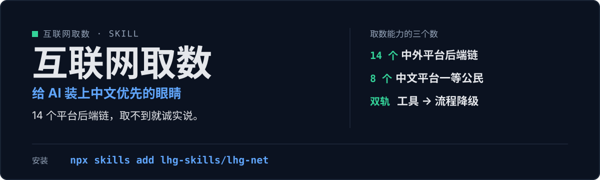

<p align="center">
  
</p>

# lhg-net · 互联网取数层

给 AI Agent 装「互联网眼睛」：14 个中外平台，每平台一条「首选 → 备选 → 纯流程降级」有序后端链；工具 → 流程双轨制，无外部工具也能跑；动手前先体检、开工先声明、只取数不分析。

（SKILL.md v1.1.0）

## 它是什么

- 中文优先：抖音 / 微博 / B 站 / 小红书 / 雪球 / V2EX / 小宇宙 / 微信公众号等 8 个中文平台为一等公民，另有 X、Reddit、YouTube、GitHub、HN、LinkedIn。
- 工具 → 流程双轨制：有外部工具走工具链，无工具 / 容器环境走纯流程（联网搜索定位 → 抓取全文 → 公开 API / 网页版直取），零外部依赖也能跑。
- 动手前先做能力体检（真实探测后端可用性，坏掉的给修复处方）。
- 安全默认：只读不发帖、Cookie 只存本地、登录态建议用小号。

## 先试一句

| 你说 | 它给你 |
|---|---|
| 帮我搜一下某平台的内容 | 先体检后端、声明用哪个平台 / 后端，再取数 |
| 抓个网页全文 / 拉个视频字幕 | 按首选 → 备选 → 纯流程降级链取回公开内容 |
| 看看某话题在各平台的讨论 | 多平台并行收集再汇总，只取数不分析 |

## 安装

```bash
npx skills add lhg-skills/lhg-net
```

<details>
<summary>发给 Agent 的安装话术（推荐：小白用户直接复制整段发给你的 Agent）</summary>

> 请帮我安装 Skill「lhg-net」：先从 Gitee 上 lhg-skills 组织下的 lhg-net 仓库下载；如果 Gitee 无法访问或下载失败，改从 GitHub 上 lhg-skills 组织下的同名仓库下载。按当前 Agent 的规范安装其中的 Skill，优先全局安装，保留完整目录和依赖。请直接执行，完成后验证是否安装成功，告诉我实际使用的来源、安装的版本号以及如何调用；遇到访问或安装限制请说明具体原因。需要输入管理员密码或确认风险时停下来等我。

**怎么算装好了**：Agent 能在已安装的 Skill 里看到 `lhg-net`，并报出版本号（与仓库 `SKILL.md` 的 `version` 一致）。只是打开了仓库网页不算安装。

</details>


## 它怎么做

1. 能力体检（真实探测后端可用性）
2. 开工声明用哪个平台 / 后端
3. 按有序后端链取数
4. 失败按重试链处理，不瞎猜
5. 多平台并行收集汇总

能力层方法论借鉴 Panniantong/Agent-Reach（MIT），文本独立重写。

## 什么时候用 / 不用

**用它，当你：**

- 搜某平台内容、抓网页全文、拉视频字幕、看某账号最近发了什么
- 没外部工具也想取数

**别用它，当你：**

- 要分析结论——只取数不分析，开放式调研走 lhg-deep-research、热点走 lhg-trend、写作走 lhg-writing
- 要它发帖——默认只读不发帖
- 取不到时它会诚实说，不编内容

## 目录结构

```
SKILL.md            skill 全文
references/
  smoke-test.md     自检用例
  fixtures/         8 个好/坏对照用例
scripts/
  smoke_test.py     冒烟脚本
LICENSE             MIT
manifest.yaml
icon-512.png
```

## 自检与反馈

冒烟：`python3 scripts/smoke_test.py references/fixtures/fixture-decision-good.md`（另有降级链、坏降级、误判调研 3 个用例，见 [references/smoke-test.md](references/smoke-test.md)；全部用例 2026-09-29 实测通过）。

发现问题请提 issue：[提一个 issue](https://github.com/lhg-skills/lhg-net/issues/new)（标题以 `[QC] ` 开头，写清你让它做了什么、它实际给了什么）。

---

## 出品：刘洪光

本 skill 由真人出镜 IP「刘洪光」（安徽合肥）出品，归属 [lhg-skills](https://github.com/lhg-skills)。

- GitHub 主页：https://github.com/lhg-skills —— 全部 skill 开源在此，欢迎 star
- 抖音：搜「刘老师讲AI实战」
- 微信：lhgsmsw

觉得有用，欢迎点 ⭐ Star。
